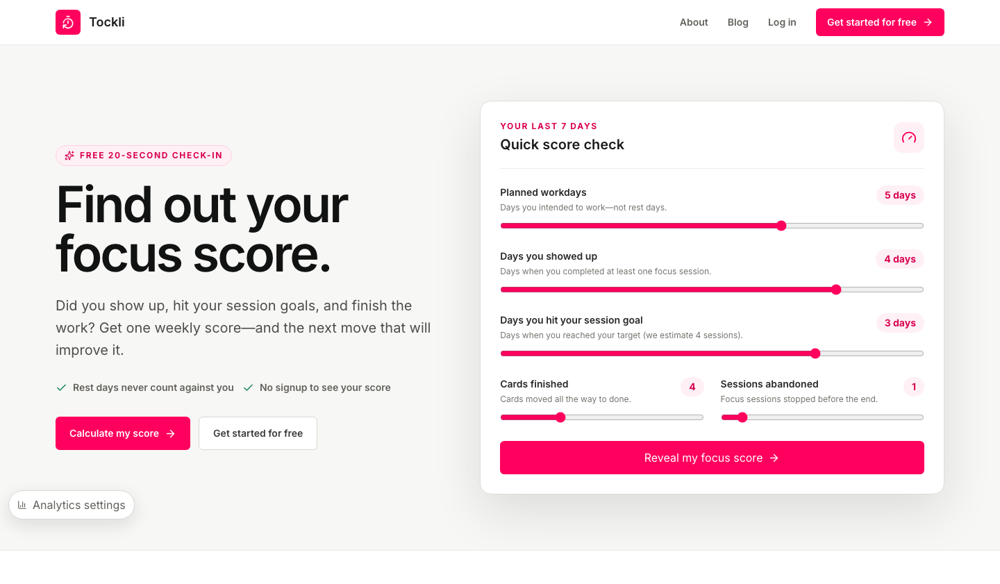

<div align="center">


# Tockli

**A personal productivity app I built for myself.**

Pick a card, run a focus session, and turn the work you finish into a weekly focus score.

[](https://github.com/connor-mcshane/tockli/actions/workflows/netlify.yml)
[](https://tockli.com)


[**Try it at tockli.com →**](https://tockli.com)

</div>

<br />

[](https://tockli.com)

## Why I made it

I wanted one place where the task I'm working on and the timer I'm running are the same thing. Most to-do apps reward looking busy. I wanted a score that only goes up when I actually show up and finish the work.

## How it works

| | |
| --- | --- |
| **Choose** | Pick the one card that matters right now. |
| **Focus** | Run the timer and protect a block of time. |
| **Bank it** | Finish the card and grow your weekly score. |

The weekly focus score is built from four things:

- **Showing up** on the days you planned to work (35 points)
- **Hitting your daily session goal** (30 points)
- **Finishing cards** (20 points)
- **Following sessions through** instead of abandoning them (15 points)

Rest days never count against you.

## Built with

Next.js and React running on [`vinext`](https://www.npmjs.com/package/vinext), TypeScript, Tailwind CSS, Supabase for auth and Postgres, and Netlify for hosting.

## Running it locally

```bash
pnpm install
pnpm run dev
```

Full setup, including the local Supabase database, environment files, tests, and deployment, is in [docs/development.md](docs/development.md).
